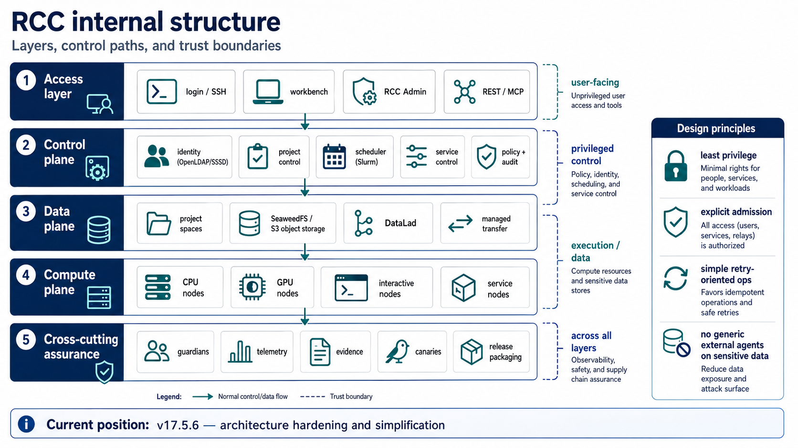

# RCC internal structure

_For computer scientists and systems researchers_

RCC separates access, privileged control, data, compute, and assurance so that the trust boundary of each operation is visible and reviewable.

_The architecture keeps ordinary user access distinct from privileged control while observability, evidence, canaries, and release assurance span the system._

_Control plane_

### Projects are the durable unit

Identity, membership, service entitlement, scheduler policy, data ownership, and lifecycle state are tied to projects rather than reconstructed independently by every application.

_Execution and data_

### Compute is replaceable; policy is not

CPU, GPU, interactive, and service nodes can evolve independently from project semantics. Object storage, managed transfer, and DataLad remain governed through the same project context.

_Assurance_

### Evidence is part of the architecture

Guardians, telemetry, canaries, and protected release packaging make deployment and recovery claims testable instead of relying on implicit operator knowledge.

_Other viewpoints_

## The same system, explained for its users and institutions

See why this architecture matters to biomedical researchers or to institutional policy and strategy.

[Medical & bio view](biomedical-research.md) [Policy view](institutional-value.md)
