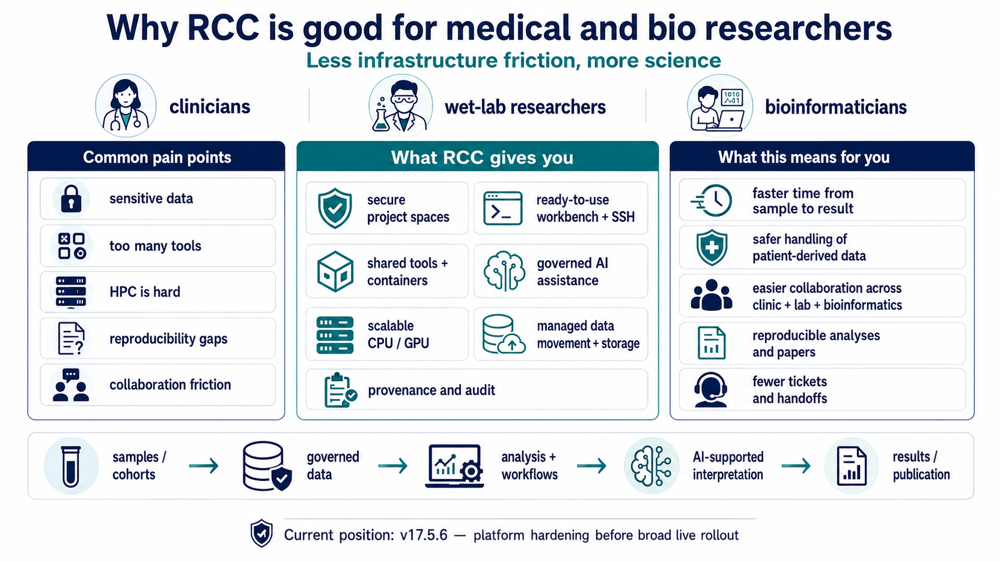

# Less infrastructure friction, more science

_For clinicians, wet-lab researchers, and bioinformaticians_

RCC gives a research project one governed place to work with data, analysis tools, CPU and GPU resources, reproducible workflows, and AI-assisted methods without requiring every group to assemble its own computing platform.

_The goal is not to turn biomedical researchers into infrastructure specialists; it is to make secure, scalable, reproducible computing a normal part of the research workflow._

_Start with the project_

### Data, people, and tools stay connected

A project can bring together clinical collaborators, laboratory scientists, and computational researchers while keeping permissions and data ownership explicit.

_Scale when needed_

### From notebook to scheduled CPU or GPU

Interactive exploration and larger analyses use the same project context. You can move from small tests to substantial computation without rebuilding the environment around the science.

_Keep the result defensible_

### Reproducibility and governance travel together

Versioned code, containers, provenance, audit evidence, and managed data movement support reproducible papers while sensitive or patient-derived data remains subject to institutional controls.

_Using RCC_

## Get your RCC identity first, then join projects

My RCC is the single place to request, activate, recover, and manage your account credentials. New accounts belong to one permanent primary group; project membership is added separately after account creation. ClusterDocs covers the practical path from first login to reproducible scheduled analysis.

[Back to RCC services and account access](https://rcc.ikim.uk-essen.de/)
