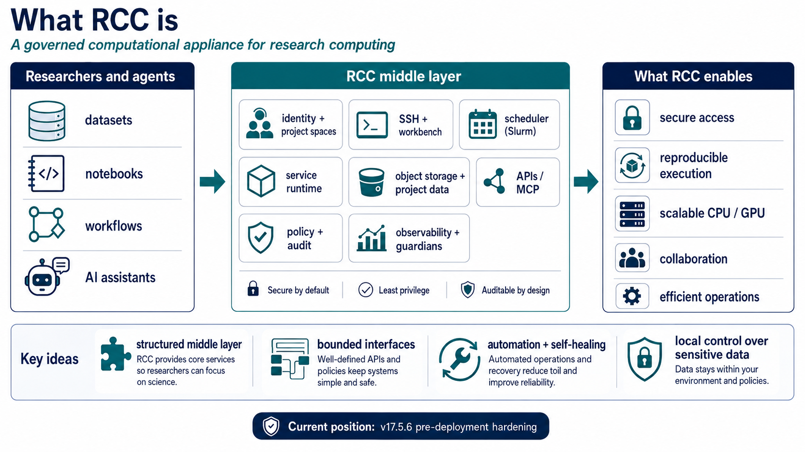

# What RCC is

_For computer scientists and systems researchers_

RCC is a governed computational appliance for research computing: a structured middle layer between researchers or agents and institutional compute, data, services, identity, policy, and operations.

_RCC is deliberately more than an HPC scheduler and less than an unrestricted cloud: it makes the institutional rules around research computation explicit and reusable._

_System idea_

### A mediated substrate, not a pile of hosts

Users, applications, and agents request bounded capabilities through project-aware interfaces. Identity, policy, data ownership, scheduling, and provenance remain part of the system rather than application-specific afterthoughts.

_Why it is interesting_

### Make the safe path the easy path

RCC combines conventional cluster mechanisms with explicit admission, auditable control paths, retained evidence, and automated recovery. The research question is how far this structure can reduce operational toil without reducing scientific flexibility.

_Agentic computing_

### Agents operate through capabilities

RCC does not require an AI agent to become a cluster administrator. The same bounded interfaces used by people and software can mediate project context, resource requests, data access, and operations.

_Go one level deeper_

## See the internal architecture and trust boundaries

The architecture view separates user-facing access, privileged control, data, compute, and cross-cutting assurance.

[Open the architecture view](architecture.md)
