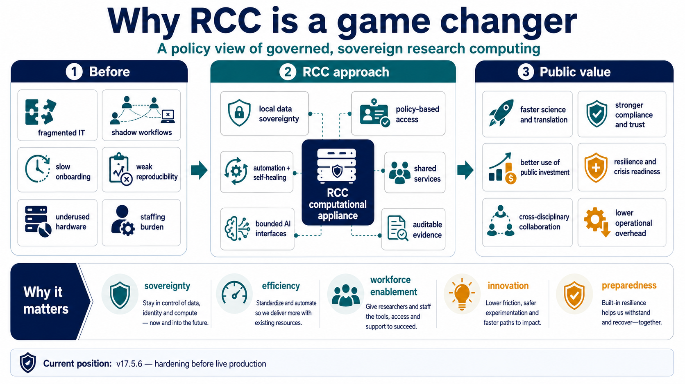

# Why RCC is a game changer

_For policy makers, research leaders, and institutional decision makers_

RCC turns research computing from a sequence of bespoke local solutions into reusable institutional infrastructure: governed locally, shared across disciplines, automatable, auditable, and designed to keep valuable research capacity available over time.

_The policy change is organizational as much as technical: common infrastructure lets institutions invest once in capabilities that many projects can use safely._

_Sovereignty_

### Keep institutional control of data and compute

RCC provides a local policy boundary for sensitive data, research identity, compute, and services while still supporting modern workflows and bounded external integration where appropriate.

_Efficiency_

### Reuse infrastructure instead of rebuilding it

Shared identity, project governance, scheduling, storage, transfer, observability, and service runtime reduce duplicated technical work and improve utilization of existing hardware and staff expertise.

_Preparedness_

### Make resilience an institutional property

Automation, evidence, canaries, and recovery mechanisms reduce dependence on individual administrators and provide a stronger base for research continuity and crisis response.

_For technical review_

## The governance claims map to explicit system boundaries

The computer-science architecture view shows where access, policy, execution, data, and operational assurance are separated.

[See the internal architecture](architecture.md)
