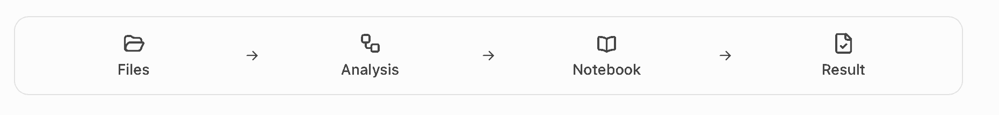

# Files → Analysis → Notebook → Result

> **Asset for future RCC documentation and user-facing feature announcements.**
> This diagram describes the intended researcher experience. It is **not** a claim that the integrated browser workflow is already available.

## Where to use it

Keep this **one canonical sequence graphic** for RCC Files onboarding, RCC Analysis / Notebook documentation, the My RCC welcome experience, and release announcements once the relevant user journey has passed its acceptance tests. Reuse the committed image asset; do not redraw subtly different variants in individual pages or announcements.

The graphic describes what researchers will do: find and upload files in their authorized project, open Analysis, use a Notebook without setting scheduler parameters, and find the results back in Files. **Result** is a saved output, not a fourth independent RCC service. Workflow execution is another Analysis mode and can be explained separately.

**Short announcement copy, only after acceptance:**

> From project data to a reproducible result: open Files, start Analysis, work in a Notebook, and retrieve your results in Files. RCC handles the compute infrastructure behind the scenes.

**Pre-release copy:**

> Coming to RCC: a browser-first path from project files through Analysis and Notebooks to saved results. We will announce access after the end-to-end pilot is accepted.

## Release and user-experience rules

- Do **not** say “available now,” “live,” or imply a successfully completed browser journey until Files/is-3, Workbench/Analysis and the no-SSH researcher acceptance are evidenced and released individually.
- The routine flow must not require an SSH key, Slurm commands, partitions, hostnames, manual path entry or repeated MFA prompts.
- Files exposes only approved project data; a single project's membership is not the limit of a user's authorized projects. A one-project account should land directly in that project.
- For accessibility provide alternative text: **EN:** “Files → Analysis → Notebook → Result: four stages from project data to a saved output.” **DE:** „Files → Analysis → Notebook → Ergebnis: vier Schritte von Projektdaten zum gespeicherten Ergebnis.“
- Preserve the sequence, generous whitespace, grayscale look and labels in images, feature announcements and landing pages. Use the actual RCC release state as separate text, rather than editing readiness labels into the artwork.
- The provided raster is 1860 × 214 pixels. Keep it uncropped and render with responsive width and its intrinsic aspect ratio.

## Provenance and ownership

- Source supplied by fm on **2026-10-26** in the RCC working discussion.
- The original, unmodified PNG is retained in the user's **RCC / User-facing-assets** Library collection as `rcc-files-analysis-notebook-result.png`.
- This repository includes a four-tone optimized PNG reproduction (same 1860 × 214 layout, reduced color gradation for smaller web delivery) with Git blob `df46d6022e9fb97be679232ebf97be621b5578f9`. The **unaltered user-provided original** remains in the Library (SHA-256 `9d6abb9acc1f13eeab2cd43510de4c93d36cb0267fc0eb6dbedd8a71e2811a83`). Reuse the original when exact pixels or higher gradation is required.
- RCC onboarding/docs owner: ClusterDocs. Source status and change/release approval remain owned by RCC; this docs-only asset is not an authorization to deploy Files, Workbench or Admin.
